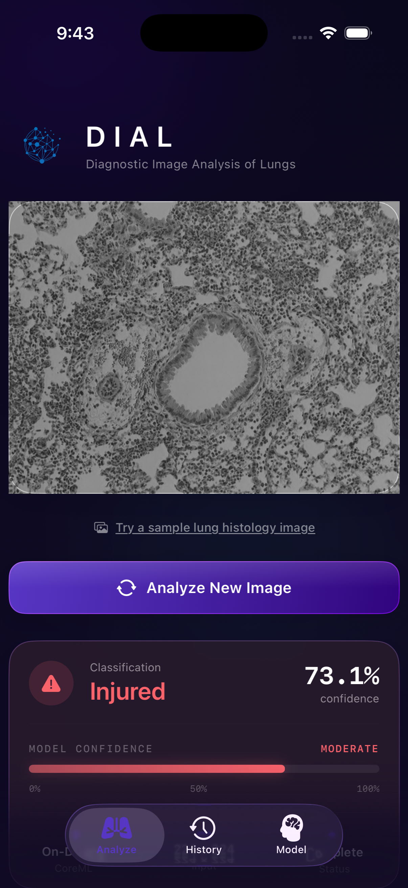
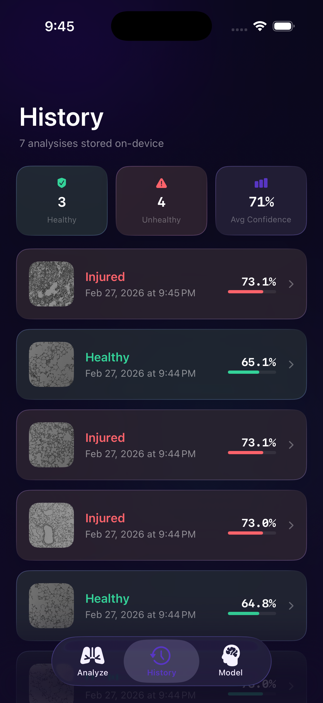
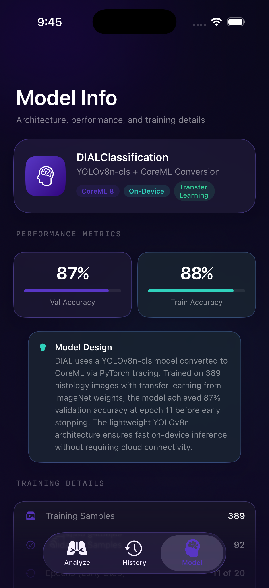

# DIAL (Diagnostic Image Analysis for Lungs)

DIAL is an iOS application designed to help researchers classify lung tissue images using a YOLOv8-based machine learning model. It distinguishes between acute lung injury (ALI) and healthy tissue, aiming to streamline sample classification, reduce variability associated with manual evaluation, and support more efficient pulmonary research.

## Overview

Classifying lung tissue samples can require significant time and specialized expertise. Differences in individual evaluation can also introduce variability into the classification process.

DIAL explores how machine learning can assist researchers by automating image classification, reducing manual review demands and helping accelerate research into potential treatments for acute lung injury.

## Screenshots

## How It Works

1. **Image Input:** Researchers upload lung tissue images through the application.
2. **Model Processing:** The YOLOv8-based model analyzes the submitted images.
3. **Classification:** The application returns a classification of acute lung injury (ALI) or healthy tissue.

## Technologies

- Swift
- SwiftUI
- YOLOv8
- Core ML

## Intended Use

DIAL is designed as a research-support tool for lung tissue image classification. Its purpose is to assist researchers with sample evaluation, not replace expert judgment or provide clinical diagnoses.

## Model Availability

The trained model package and associated private research assets are not included in this public repository.

